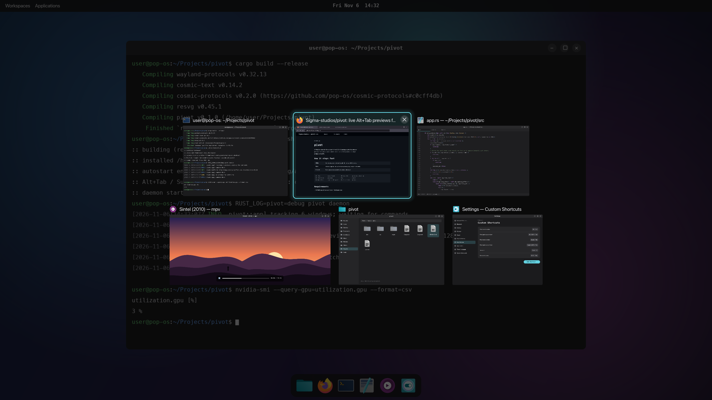

# pivot

A Windows-style Alt+Tab switcher for the **COSMIC** desktop: a grid of **live window previews**
that update at your monitor's refresh rate, with the preview pixels kept entirely on the GPU.


<sub>Mockup. The switcher is drawn by pivot's real layout and rendering code; the app windows behind it are synthetic.</sub>

> **Status: early.** pivot builds and its layout code is unit-tested, but it has not yet had
> much real-world use on COSMIC. Bug reports with `RUST_LOG=pivot=debug` logs are very welcome.

```
Alt+Tab            open / next          Release Alt      switch to selection
Alt+Shift+Tab      previous             Esc              cancel
Arrows / hjkl      move in the grid     Enter / click    switch
W / Q / Delete     close selected window (also middle-click or the × button)
Scroll wheel       move selection       Click outside    cancel
```

A quick Alt+Tab tap (released before `show_delay_ms`) flips to the previous window without
showing the grid, like Windows does.

## How it stays fast

| State  | Cost |
|--------|------|
| Idle   | One sleeping process blocked in `poll()`. It only tracks the window list and most-recently-used (MRU) order from Wayland events. No timers, no rendering, no GPU memory. |
| Open   | Each window is captured with `ext-image-copy-capture-v1` into a **GBM dmabuf** (a GPU-to-GPU blit done by the compositor). That same buffer is attached to a `wl_subsurface` and scaled with `wp_viewport`, so COSMIC downsamples it during its normal composite pass. Window pixels never reach the CPU or this process. |
| Closed | Every capture session, buffer and surface is destroyed, so all the VRAM is freed. |

**Frame rate:** a window gets a new frame only when it actually redraws (the compositor reports
damage). So a playing video or game updates at up to your monitor's refresh rate (60, 144 or
240 Hz), and a static window costs nothing. Set `max_fps` if you want a cap.

The titles, icons and highlight are a small shared-memory buffer drawn with tiny-skia. It is
redrawn only when the selection or a title changes, never per video frame.

If a GPU path is missing (no GBM, or the driver rejects the dmabuf), pivot falls back to
shared-memory capture for that window automatically. That fallback works but is slower.

## Requirements

- COSMIC (epoch 1 or later). cosmic-comp must expose `ext_foreign_toplevel_list_v1`,
  `zcosmic_toplevel_info_v1` v2+, `zcosmic_toplevel_manager_v1`, `zwlr_layer_shell_v1`,
  `ext_image_copy_capture_manager_v1` and `ext_foreign_toplevel_image_capture_source_manager_v1`.
  Without the two capture globals, pivot still works but shows icons instead of previews.
- Building from source: Rust ≥ 1.80 and libgbm (`sudo apt install libgbm-dev` on Pop!_OS).

## Install

### NixOS (flake)

```nix
# flake.nix
inputs.pivot = {
  url = "github:Sigma-studios/pivot";
  inputs.nixpkgs.follows = "nixpkgs";
};

# in your nixosSystem modules
modules = [
  inputs.pivot.nixosModules.default
  { programs.pivot.enable = true; }
];
```

That's all: no manual step. The module installs pivot, autostarts the daemon in COSMIC, and binds
Alt+Tab, Alt+Shift+Tab, Super+Tab and Super+Shift+Tab. It binds the keys by shipping a
system-wide COSMIC shortcut file in `/run/current-system/sw/share/cosmic/`, next to COSMIC's own
default bindings.

There is one COSMIC quirk to know about. Your personal shortcut file
(`~/.config/cosmic/com.system76.CosmicSettings.Shortcuts/v1/custom`, created the first time you
change any shortcut in COSMIC Settings) **replaces** the system-wide file rather than merging with
it. To cover that case, the daemon adds the pivot bindings to your personal file at startup if
they're missing, after making a backup (`patchUserShortcuts`, on by default).

| Option | Default | |
|---|---|---|
| `programs.pivot.autostart` | `true` | Start the daemon with the session (otherwise it starts on the first Alt+Tab) |
| `programs.pivot.bindAltTab` | `true` | Ship the system-wide Alt/Super+Tab bindings |
| `programs.pivot.patchUserShortcuts` | `= bindAltTab` | Add the bindings to your personal shortcut file if you have one |

**With [cosmic-manager](https://github.com/HeitorAugustoLN/cosmic-manager)** (home-manager), set
`programs.pivot.patchUserShortcuts = false` and declare the bindings alongside your others:

```nix
wayland.desktopManager.cosmic.shortcuts = let
  spawn = cmd: cosmicLib.cosmic.mkRON "enum" { variant = "Spawn"; value = [ cmd ]; };
in [
  { key = "Alt+Tab";         action = spawn "pivot next"; }
  { key = "Alt+Shift+Tab";   action = spawn "pivot prev"; }
  { key = "Super+Tab";       action = spawn "pivot next"; }
  { key = "Super+Shift+Tab"; action = spawn "pivot prev"; }
];
```

**Uninstalling:** if the daemon ever patched your personal file, run `pivot remove-shortcuts`
before removing pivot. Otherwise Alt+Tab keeps calling a program that's gone.

To try it without installing: `nix run github:Sigma-studios/pivot -- daemon`.

### Other distributions

```sh
./dist/install.sh
```

This does the following:

1. Builds the binary and installs it to `~/.local/bin/pivot`.
2. Adds the autostart entry `~/.config/autostart/pivot.desktop`.
3. Writes a default `~/.config/pivot/config.toml`.
4. Binds Alt+Tab, Alt+Shift+Tab, Super+Tab and Super+Shift+Tab via `pivot setup-shortcuts`.
5. Starts the daemon.

`./dist/uninstall.sh` removes everything except your config.

### Binding the keys by hand

Custom shortcuts override COSMIC's built-in `WindowSwitcher` bindings for the same keys. Add this
to `~/.config/cosmic/com.system76.CosmicSettings.Shortcuts/v1/custom` (RON):

```ron
{
    (modifiers: [Alt], key: "Tab"): Spawn("pivot next"),
    (modifiers: [Alt, Shift], key: "Tab"): Spawn("pivot prev"),
}
```

To get COSMIC's own switcher back, remove those lines (or run `pivot remove-shortcuts`).

## Commands

`pivot daemon [--ensure-shortcuts] | next | prev | show | toggle | hide | quit | setup-shortcuts [CMD] | remove-shortcuts [CMD]`

`next` and `prev` start the daemon if it isn't running. `show` and `toggle` open a "sticky"
switcher that doesn't close when you release Alt, which suits mouse or gesture bindings.

## Configuration

See [`dist/config.toml`](dist/config.toml). The file is re-read every time the switcher opens.
Colors follow COSMIC's dark/light mode and accent color unless you override them.

The default look is no panel, a dimmed desktop and a glowing selection. The look is fully
configurable: panel opacity, outline, per-window cards, five selection styles, and contrast aids
for light backgrounds (title halo, thumbnail shadows, title pills, and a feathered scrim behind
the grid). Preset comparisons:

- [`docs/styles.png`](docs/styles.png): eight looks
- [`docs/light-backgrounds.png`](docs/light-backgrounds.png): the default against contrast aids,
  over a dark and a white desktop

There is no blur behind the switcher: pivot can't see what's underneath it, so transparency
shows the desktop unblurred.

## Debugging

```sh
pivot quit; RUST_LOG=pivot=debug pivot daemon
```

The log shows which DRM render node the preview buffers are allocated on. It also warns if
dmabuf capture falls back to shared memory.

## Layout of the code

| File | Purpose |
|------|---------|
| `src/app.rs` | Wayland state, toplevel/MRU tracking, overlay lifecycle, input, capture scheduling |
| `src/capture.rs` | Per-window capture session, buffer slots and the frame pipeline |
| `src/buffers.rs` | GBM dmabuf allocation, render-node lookup, memfd/shm |
| `src/layout.rs` | Grid layout (uniform height, aspect-correct widths, balanced rows) |
| `src/render.rs` | Switcher chrome drawing (tiny-skia + cosmic-text) |
| `src/icons.rs` | app_id → .desktop → icon theme → pixmap |
| `src/ipc.rs` | Control socket (`$XDG_RUNTIME_DIR/pivot-$WAYLAND_DISPLAY.sock`) |
| `src/shortcuts.rs` | `setup-shortcuts`: merges bindings into COSMIC's RON shortcut file |
| `nix/` | Nix package and NixOS module |

## License

MIT
